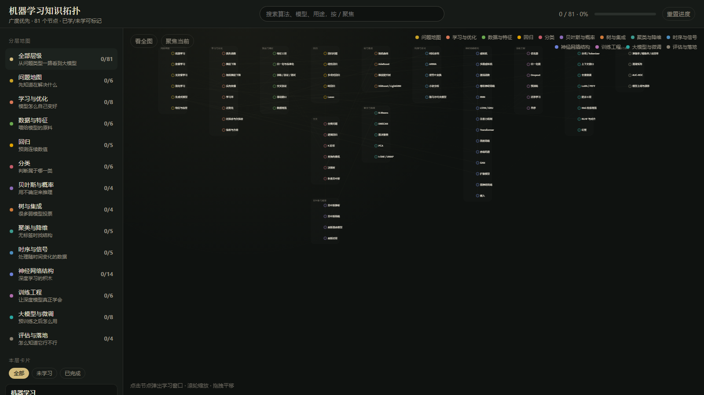

# 机器学习知识拓扑

[](https://nodejs.org/)
[](https://vite.dev/)
[](https://react.dev/)

两张可以切换的个人知识图，进度都只存在这台设备的浏览器里。

- **机器学习**：回归、分类、贝叶斯、树模型、神经网络、大模型微调，先放进同一张拓扑，搞清楚「它是干什么的、什么时候用、别和什么搞混」。
- **电芯材料**：液态锂离子和固态（硫化物、氧化物、聚合物、卤化物、半固态）之间，离子电导、电化学窗口、界面阻抗、面容量这些参数怎样互相促进、抑制或制约。点开节点可以看到液态和固态的差别。数量级来自公开文献的常见范围，不是某一配方的规格。

顶栏可以在两张图之间切换。手机浏览器里用「添加到主屏幕」安装后，页面资源会缓存在本机，离线也能打开；学习标记仍在本地，清除站点数据会丢掉。



点任意节点会弹出近全屏学习窗口，里面同时有通俗介绍、专业定义、展开讲解、公式、示例代码和示意图。看懂一块就点「已完成」，进度存在浏览器本地。

仓库地址：[github.com/Shymelly/ml-knowledge-topology](https://github.com/Shymelly/ml-knowledge-topology)

## 里面有什么

- **13 层、81 个节点**：从问题地图（监督 / 无监督 / 强化 / 生成）一直走到大模型与评估落地
- **可缩放拓扑图**：默认连线较暗，点中节点后只高亮与它相连的边；滚轮缩放、拖拽平移
- **学习窗口**：通俗介绍 + 专业定义 + 展开讲解 + 要点 + LaTeX 公式 + 代码 + 样例图
- **学习进度**：每个节点可标记已完成 / 未学习，进度条按整体统计
- **搜索**：顶栏搜索，或按 `/` 聚焦搜索框

覆盖范围包括：线性/逻辑回归、SVM、决策树、随机森林、GBDT/XGBoost、朴素贝叶斯、K-Means、PCA、小波与傅里叶、梯度下降、滑动窗口、CNN/RNN/Transformer、LoRA 微调、RAG、RLHF 等。

## 建议怎么逛

1. 从左侧「问题地图」建立大局：监督学习、无监督、强化学习、生成式模型。
2. 再看「学习与优化」：损失、梯度下降、过拟合。这是后面几乎所有模型共用的语言。
3. 按任务走进回归 / 分类 / 树与集成；有图像或序列再进神经网络；要用 ChatGPT 一类系统再看大模型。
4. 每个节点先读通俗介绍和类比，再读专业定义与展开讲解。只求先建立地图，不必一次记住公式推导。
5. 看懂就点「标记为已完成」。可以用顶部筛选只看「未学习」。

## 运行

需要先安装 [Node.js LTS](https://nodejs.org/)。在项目目录执行：

```bash
npm install
npm run dev
```

浏览器会打开 [http://localhost:5173/](http://localhost:5173/)。
机器学习首页.png
| 操作 | 说明 |
| --- | --- |
| 点击节点或左侧卡片 | 弹出学习窗口 |
| `Esc` / 点遮罩 / 关闭 | 收起窗口，拓扑图恢复全宽 |
| 滚轮 / 拖拽 | 缩放、平移拓扑图（按住拖过一小段才会平移） |
| `/` | 聚焦搜索 |
| 看全图 / 聚焦当前 | 图左上角，复位或缩放到当前节点邻域 |

进度保存在浏览器本地：机器学习是 `ml-topology-progress-v1`，电芯材料是 `cell-topology-progress-v1`。清除站点数据或点击「重置进度」会丢失当前这张图的标记，不会上传到服务器。

## 装到手机上

这是一个 PWA（Progressive Web App，渐进式网页应用）：本质上仍是这个网站，但带有一份安装清单和离线缓存。

1. 先执行 `npm run build`，再用 `npm run preview` 打开，或把构建结果部署到 HTTPS 网站。开发服务器 `npm run dev` 不会装上离线缓存。
2. 手机 Chrome：菜单里选「安装应用」或「添加到主屏幕」。
3. iPhone Safari：分享按钮里选「添加到主屏幕」。
4. 之后可以从主屏幕打开，没有网络时也能看已经缓存的知识图。字体若来自外网，离线时会退回系统字体，内容还在。

## 截图怎么更新

首页图在 [`docs/home.png`](docs/home.png)。以后界面改了，可以：

1. 运行 `npm run dev`，打开首页。
2. 用系统截图（Windows：`Win + Shift + S`）或浏览器全页截图。
3. 把新图覆盖保存为 `docs/home.png`（建议宽度 1400px 以上，PNG）。
4. 提交并推送：

```bash
git add docs/home.png README.md
git commit -m "Update README screenshot"
git push
```

GitHub 仓库页面会自动渲染 README 里的相对路径图片，无需外链图床。

## 技术

Vite + React + TypeScript。拓扑图用 Canvas 自绘，公式用 [KaTeX](https://katex.org/)，进度只存在本地。
